# Music School CRM: Salesforce Admin Portfolio Project

I built a Salesforce CRM for a fictional music school with three locations. It routes new inquiries to the right studio, reminds staff when a lead goes cold, converts inquiries into students, keeps each front desk to its own studio's records, and gives the owner, the front desk, and the enrollment director their own dashboards.

Built solo in a Salesforce Developer Edition org with sample data, September 2026. All of the org configuration is declarative: Flow Builder, validation rules, permission sets, sharing rules, and Lightning reports and dashboards.

Tableau dashboard on this org's inquiry data: see [/tableau](tableau/).

**Salesforce Certified Platform Administrator**

**[Watch the 5-minute demo](https://youtu.be/cb_qSZLVt1I)** · [LinkedIn](https://www.linkedin.com/in/gavyn-singer/) · [Verify certification](https://trailhead.salesforce.com/en/credentials/certification-detail-print/?searchString=mqmguzTDDOdm33I+/MR65skwKcnP63bJT0eFOE2tuioxZF80wNz4JYleLjQcD1mI)

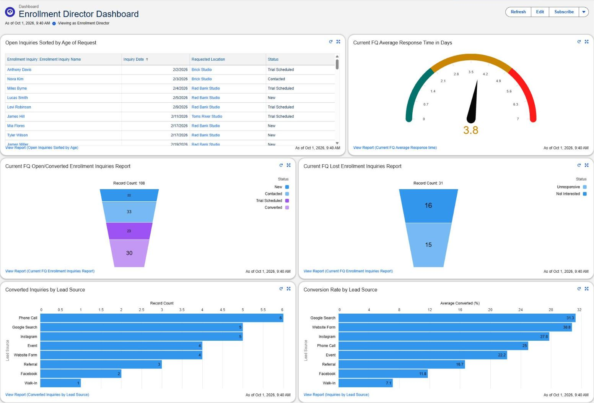

---

## Why I built this

I worked as an operations assistant at a music academy, scheduling lessons across two locations. This is the system I wish we had. I've also worked as a BDR, where a fast first response and steady follow-up were most of the job, so I built both into the inquiry process.

I started by writing out who uses the system and what each person needs to see, edit, and decide, based on the roles at the academy: a front desk at each studio, an owner who watches revenue, and an enrollment director who needs to know which leads are going cold. That list drove the security model and the reports.

## What's in it

| Area | What I built |
|---|---|
| Flow | Record-triggered, scheduled, and screen Flows: lead routing, follow-up tasks, response tracking, and inquiry-to-student conversion |
| Security | Minimal profile with permission sets by job, role hierarchy, org-wide defaults, sharing rules, field-level security |
| Data quality | 7 validation rules, a duplicate rule on Student, required fields, and cleanup of duplicate and bad records |
| Data loads | Data Loader inserts, updates, and upserts on External IDs, plus a recovery with undelete |
| Reports and dashboards | 4 dashboards, including an enrollment funnel, conversion rate by lead source, and time to first response |
| Data model | 4 custom objects plus the standard Location object, with Lightning record pages |
| Testing | Login As tests for every test user, including tests that were supposed to fail |
| Data analysis | Exported the org's data to Excel, audited it for 10 data-quality issues, and tied each one to a Salesforce fix ([analysis](analysis/README.md)) |
| Documentation | This README and [project notes](docs/project-notes.md) covering each error I hit and how I fixed it |

---

## How the enrollment process works

1. A family asks about lessons. An **Enrollment Inquiry** record is created.
2. A Flow routes it to the queue for the studio the family asked about (Red Bank, Brick, or Toms River).
3. When staff log a call on the inquiry, a Flow stamps the **First Response Date** and moves the status from New to Contacted.
4. If nobody responds within 3 days, a scheduled Flow creates a follow-up task for the Enrollment Director. It runs every morning and never creates a second task while the first one is still open.
5. After a trial lesson, staff run the **Inquiry to Student** screen Flow, which creates the Student record and marks the inquiry Converted.
6. Lessons are booked against the student and an instructor. Cancellations, no-shows, and makeup lessons are tracked on each lesson.
7. The enrollment director watches the funnel, the front desk sees the week's lessons and cancellations, and the owner sees revenue and churn.

---

## Problems I ran into

The full list is in the [project notes](docs/project-notes.md). These are the ones I learned the most from.

**1. I deleted every instructor by accident.**
I meant to delete duplicate instructor records and deleted all of them. Because Lesson is master-detail to Instructor, every lesson went with them. I restored everything from the Recycle Bin with Data Loader's undelete. One instructor wouldn't restore because he broke a validation rule (active, no background check), so I turned the rule off, restored him, and turned it back on. Then I checked lesson counts against the source file to confirm nothing was lost. I check the row count of any delete file before running it now.

**2. A Flow erased a student's email.**
The scheduled Flow that moves a student's email back when they turn 18 ran for the first time and left both fields blank. My theory was that the two field updates ran in the wrong order, so the old field was cleared before its value was copied. I tested it in debug, and the order was the problem. I split it into two update steps so the order is visible on the canvas, restored her email from the source file, and turned on field history tracking so there's an audit trail next time.

**3. Front desk users couldn't book lessons.**
The Lesson-to-Instructor master-detail relationship required edit access on the instructor, and front desk only has read access. The quick fix was to give them edit access to instructors. The better fix was to change that relationship's sharing setting to require only read access, since booking a lesson shouldn't come with the ability to edit instructor pay or background check dates. I left the Student side requiring edit access on purpose, which is what stops a front desk from booking lessons for another studio's students. Tested both ways: a Brick student saves, a Red Bank student is blocked.

**4. A report worked for me and showed nothing for the Enrollment Director.**
A dashboard showed an average response time of 1.1 days for me and 0 for the Enrollment Director. I went through permission sets, field-level security, folder access, and record access first. The cause was simpler: the report was set to "My enrollment inquiries." I own every record in my dev org, so it looked fine to me and returned nothing for anyone else. The same setting had caught me on the Owner dashboard a week earlier, which is why I now open every dashboard as the person it's for.

---

## Auditing the org's own data

After the build, I exported the org's lessons, students, instructors, and inquiries to Excel and audited them the way I would a real company's data. The full write-up is in [analysis/README.md](analysis/README.md).

- **93 past lessons were still marked Scheduled.** That made September look like completed lessons fell from 90 in July to 31. After closing them out, September matches August at 64.
- **The close rate was 34.5%, not 50%.** 57 inquiries had been sitting open for more than a month, which inflated it, and 19 never got a response.
- **Brick cancels 18% of its lessons**, almost double Red Bank's 10%, and 23 of those were cancelled by instructors.
- **10 data-quality checks** with live counts, each tied to the Salesforce change that would prevent it.

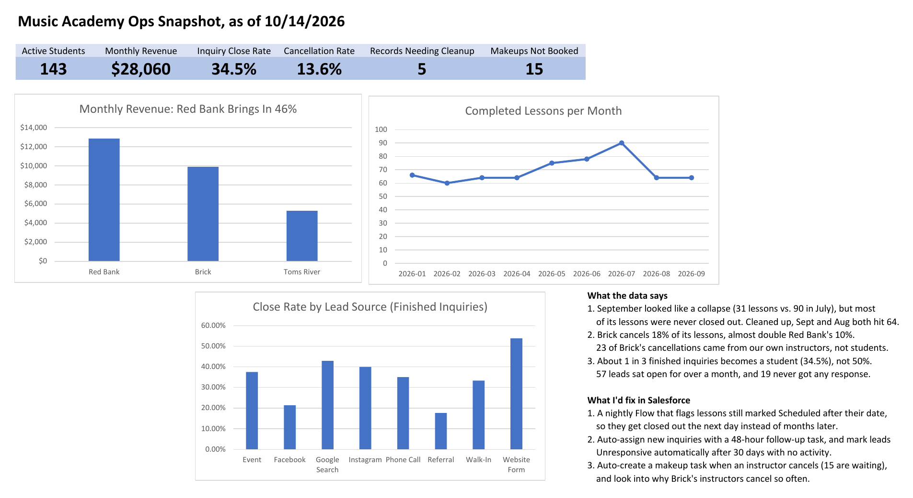

---

## What I built

### Data model

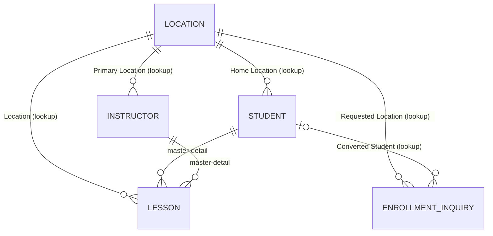

Lesson is master-detail to both Student and Instructor so I could use roll-up summaries on both (lesson counts, cancellations, last cancelled date). That uses up both master-detail slots, so Lesson's link to Location is a lookup. Every object has a unique External ID so data loads match records instead of creating duplicates.

Sample data: 3 studios, 46 instructors (15 active), 182 students, 1,328 lessons (scheduled through March 2027), and 140 enrollment inquiries.

### Lead management

- **Routing:** assignment rules only work for Leads and Cases, so a record-triggered Flow assigns each new inquiry to its studio's queue. It finds the queue by its API name instead of a hardcoded ID.
- **First response:** the first call or other activity logged on an inquiry sets First Response Date (the auto-created follow-up task doesn't count). The status only moves forward if it's still New, so a later call can't knock an inquiry back from Trial Scheduled.
- **Follow-up:** the scheduled Flow skips any inquiry that already has an open auto-created task, so it never duplicates. If a task gets marked complete but nobody actually responded, the reminder comes back the next morning. If creating the tasks fails, it emails me the error.
- **Conversion:** the screen Flow checks that the inquiry hasn't already been converted, pre-fills the student form, calculates age from birthday, and shows a guardian screen for anyone under 18. Contact info goes to the student's fields for adults and the guardian's fields for minors.

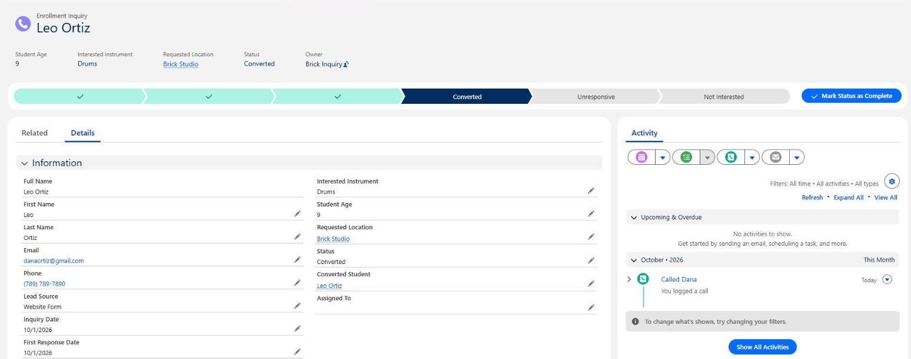

<details>
<summary>More screenshots: routing Flow, follow-up Flow, follow-up tasks, conversion Flow, guardian screen</summary>

**Lead routing Flow.** One branch per studio, plus a branch for inquiries with no location.

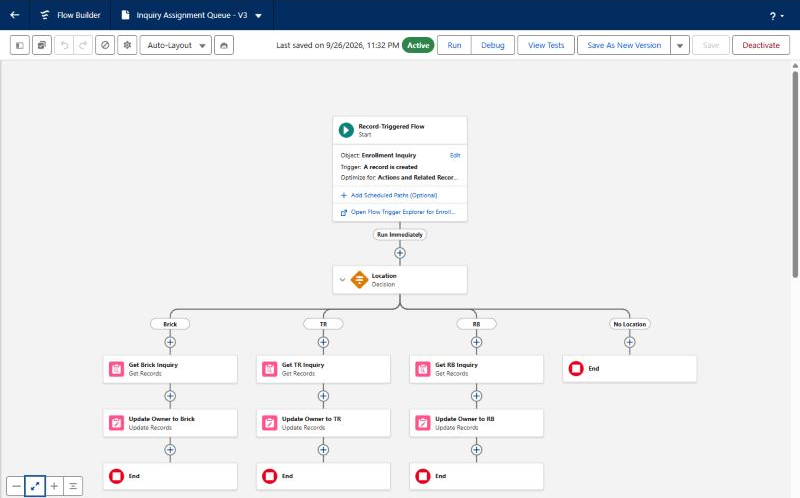

**Follow-up Flow.** Collect inquiries that already have an open task, find stale inquiries that don't, build one task each, save them all at once. The dashed line is the fault path that emails me if the save fails.

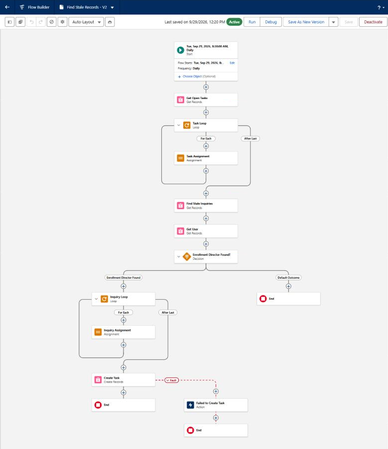

**Follow-up tasks it created,** assigned to the Enrollment Director with the auto-generated flag checked.

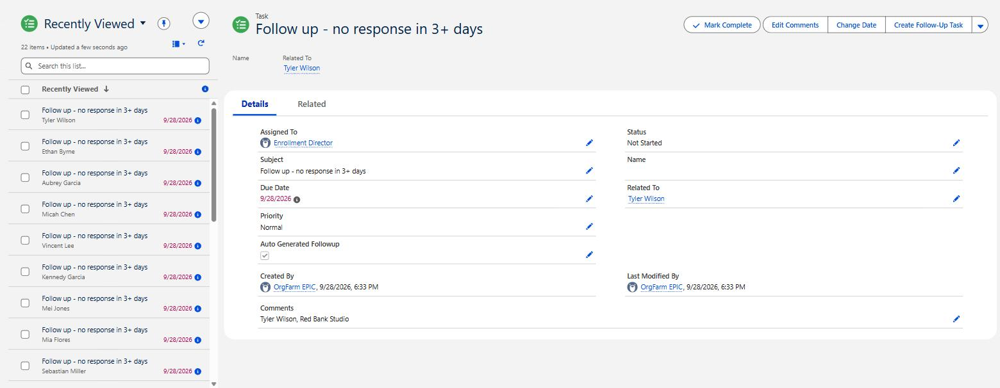

**Conversion Flow.** Stop if the inquiry is already a student. Otherwise collect the student's info, split on age, prefill the student's or guardian's contact info so staff can confirm it, create the Student, and mark the inquiry Converted. The dashed lines go to error screens.

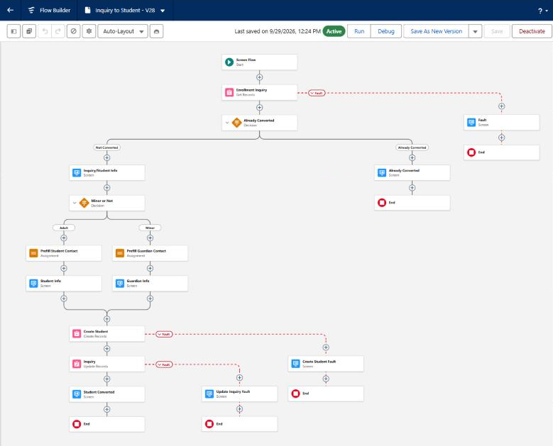

**Guardian screen** in the conversion Flow, shown when the student is under 18.

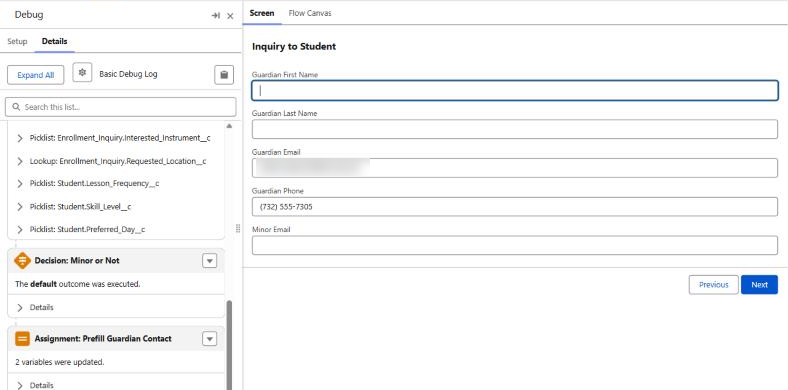

</details>

### Security model

There's one base profile with no object permissions, and all access comes from permission sets, one per job (Front Desk, Office Director, Marketing Director, Enrollment Director, Owner). Music Director has a role but no permission set yet, and the Developer Edition's license limit means only five test users can be active at once.

```
Owner
├── Enrollment Director
├── Marketing Director
├── Music Director
└── Office Director
    ├── Front Desk - Red Bank
    ├── Front Desk - Brick
    └── Front Desk - Toms River
```

- **Org-wide defaults:** students, instructors, and studios are Public Read Only. Inquiries are Public Read/Write so any front desk can take a call for any studio.
- **Sharing by studio:** each front desk can edit only its own studio's students. Criteria-based sharing rules can't use lookup fields, so I added a Home Studio picklist, kept in sync with the Home Location lookup by a Flow, and based the rules on that.

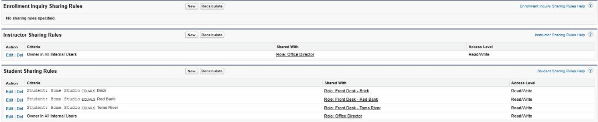

<details>
<summary>More: minors' contact info, report folders, role hierarchy, Front Desk permission set</summary>

- **Minors' contact info:** a minor's email is moved into a separate field that only some permission sets can see. A Flow moves it the moment it's saved, and a scheduled Flow moves it back when the student turns 18. Validation rules require full guardian contact info for anyone under 18.
- **Report folders** are shared only with the people who need them. The revenue reports are visible to the owner and me.

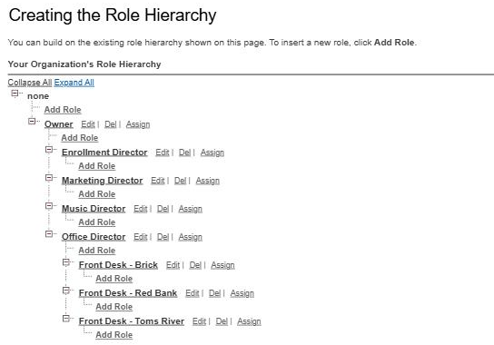

**Front Desk permission set.** Read, create, and edit on inquiries, lessons, and students. Read only on instructors and studios. No delete.

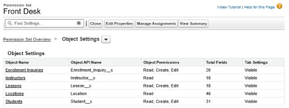

</details>

### Data quality

- **7 validation rules:** lesson status must match the lesson date, completed lessons need a duration, active instructors need a background check date, new students need a birthday, minors need full guardian contact info, a minor's own phone number can't be saved, and a parent or guardian who pays for an adult student needs contact info on file.
- **Duplicates:** at one point every instructor existed twice, most likely because a load ran twice before the External ID was set to Unique. I used a lesson-count roll-up to tell which copy was safe to delete, removed the duplicates by hand, and turned on Unique for the External ID fields.
- **Duplicate rule:** a new student is flagged when first name, last name, and either guardian email or student email match an existing student. Requiring the first name and an email to match means siblings (same last name and guardian email) and two kids who share a name aren't flagged. It warns instead of blocking, so staff can open the existing record or save anyway. I tested it on two existing duplicate pairs: one matched on guardian email, and the other matched on student email even though one record's first name is in all caps.

<details>
<summary>More: data loads, planted problems, roster cleanup, validation and duplicate rule screenshots</summary>

- **Loads:** Data Loader (plus dataloader.io and the Data Import Wizard early on), using upsert on External IDs so a failed load could be re-run without creating duplicates. Parents loaded before children.
- **Planted problems:** the sample data came with deliberate issues (a malformed email, missing required fields, an active instructor with no background check) so there would be real cleanup to do.
- **Roster cleanup:** 46 instructors for 181 students wasn't realistic, so I cut active instructors to 15 based on weekly lesson demand at each studio, then reassigned their future lessons with Data Loader.

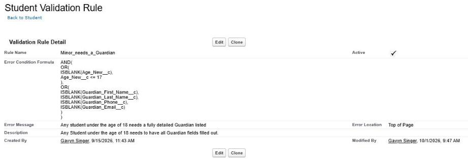

**Duplicate rule** and the warning front desk sees when a new student matches an existing one.

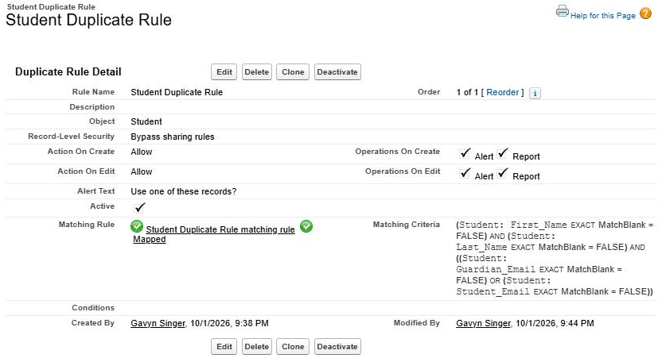

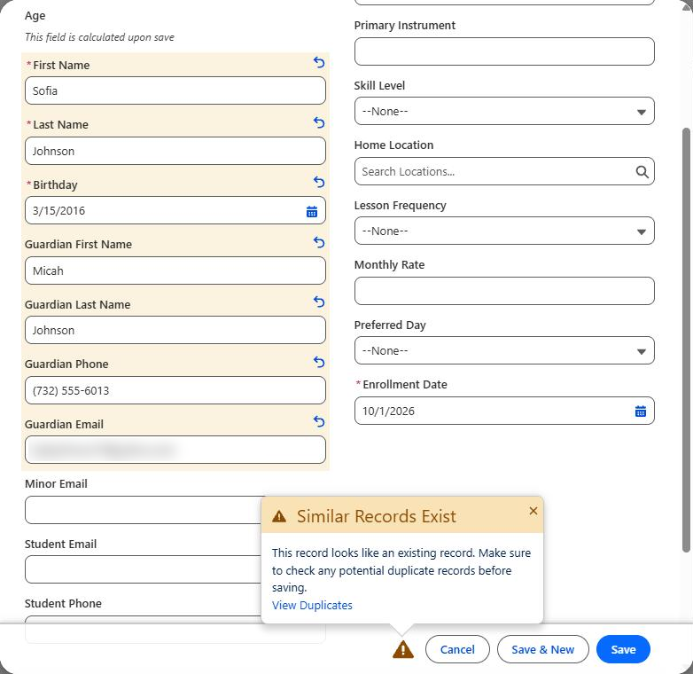

</details>

### Reports and dashboards

| Dashboard | Who it's for | What it shows |
|---|---|---|
| Enrollment Director | Enrollment | Open inquiries by age, average days to first response, open and lost inquiries by stage, conversions and conversion rate by lead source |
| Owner | Owner | Revenue in total and by studio, active students and instructors by studio, active students vs. goal, the inquiry funnel, enrolled vs. withdrawn |
| Next 7 Days of Lessons | Front desk | The week's schedule, filtered by studio (the Front Desk app's home page) |
| Cancellations | Front desk | Cancellations by studio, students who cancel repeatedly, lessons cancelled by instructors, makeup lessons still owed |

Both front desk dashboards have a studio filter and run as whoever is viewing them, so one dashboard works for all three studios.

Reports titled "Current FQ" are named for the window a real school would watch. With fixed sample data, a quarter filter empties out every three months, so those reports are set to the last 365 days.

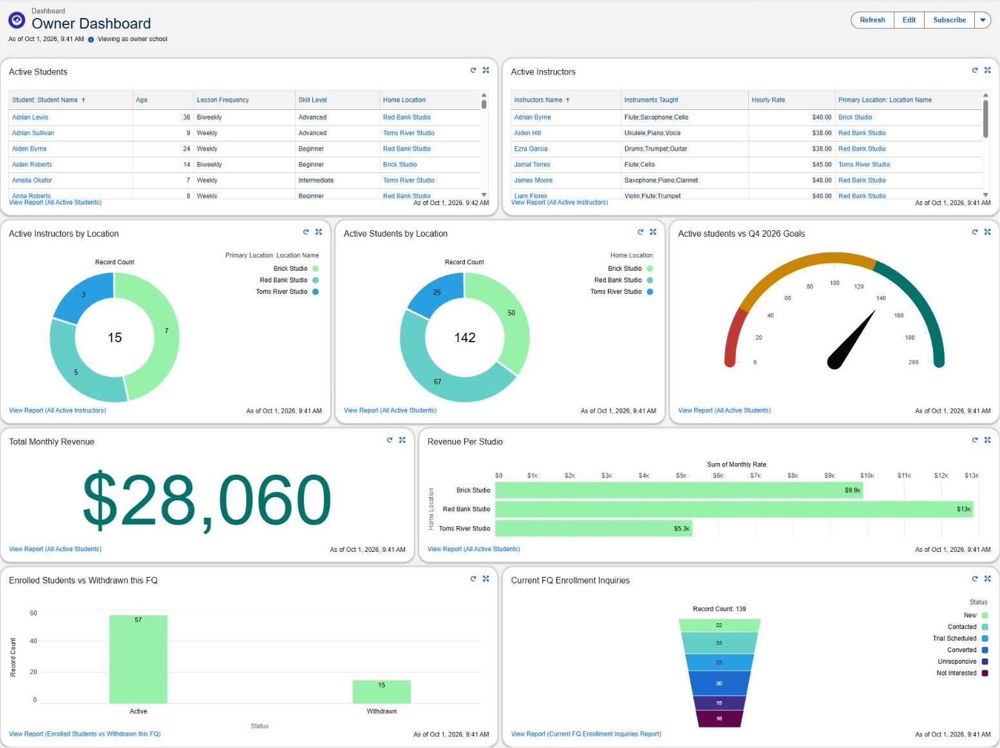

<details>
<summary>More screenshots: front desk home page, cancellations dashboard</summary>

Repeat cancellations come from a roll-up summary on Student, and that report is built on the plain Students report type so it shows one row per student instead of one per lesson.

**Front Desk app home page,** logged in as the Brick front desk user.

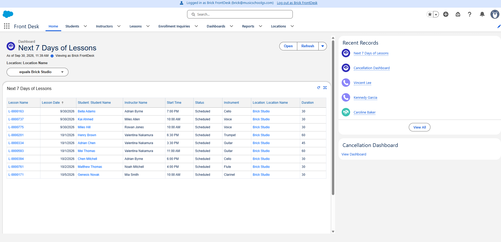

**Cancellations dashboard** filtered to Brick.

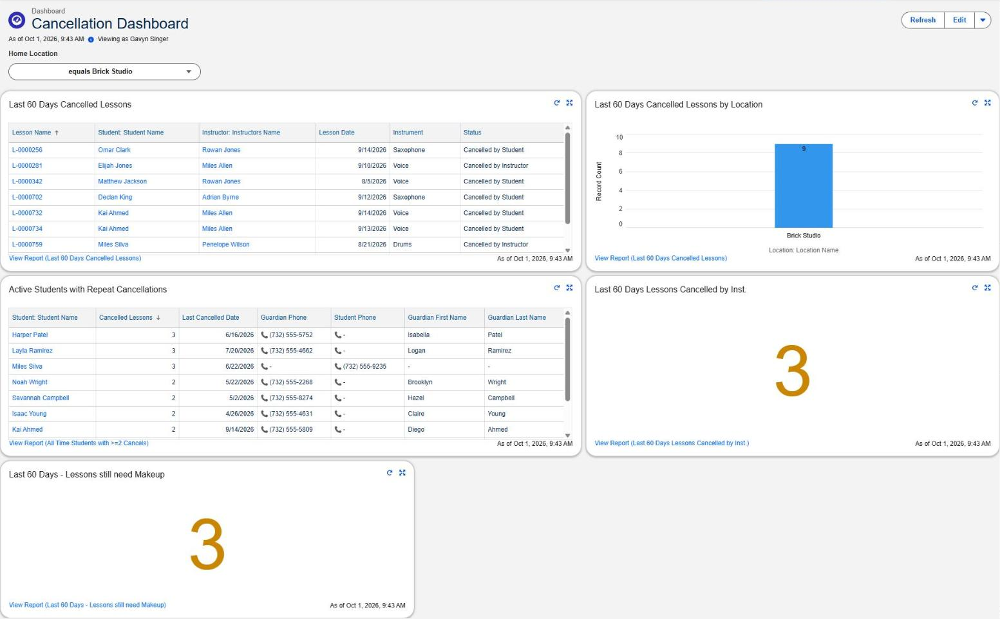

</details>

---

## How I tested it

- Used **Login As** for each test user (Front Desk at two studios, Office Director, Marketing Director, Enrollment Director, Owner) and ran specific pass/fail tests for each.
- Ran tests that should fail, like a front desk user booking a lesson for another studio's student, or saving a minor without guardian info.
- Debugged each Flow and checked what it actually changed, not just that it finished. For the scheduled Flow, one run created 19 follow-up tasks and the next run created 0, which showed it doesn't duplicate.
- Opened every dashboard as the person it was built for.

<details>
<summary>Screenshots: blocked saves</summary>

**Brick front desk booking a lesson for a Red Bank student.** Blocked, because the Student side of the lesson still requires edit access on the student.

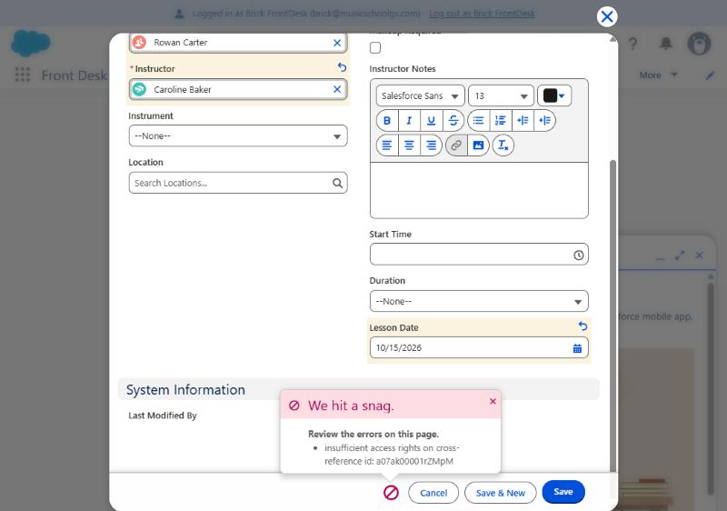

**Saving a student under 18 with no guardian info.** Blocked by the validation rule.

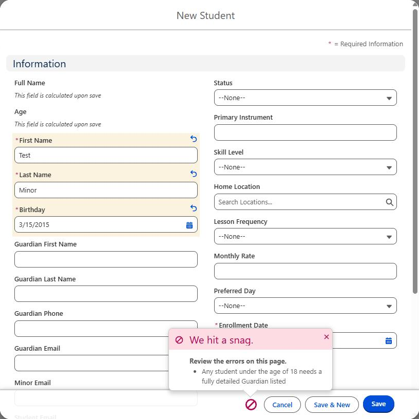

</details>

---

## What I'd do differently

- **Use the standard Lead object.** I modeled inquiries as a custom object and didn't consider Leads at the time. Leads come with built-in conversion, assignment rules, and web-to-lead. The tradeoff is that Lead conversion creates an Account and Contact (and optionally an Opportunity), while this school's customers are Students, so I'd need to weigh that.
- **Route by External ID.** The routing Flow branches on the studio's name, so renaming a studio would break it. It also has one branch per studio and only runs when an inquiry is created.
- **Merge the duplicates already in the org.** The duplicate rule checks records as they're saved, so the three duplicate students that came with the sample data are still there.
- **Assign follow-up tasks to a queue** instead of one named user.
- **The funnel shows current status, not stages reached.** A converted inquiry passed through Trial Scheduled but only counts as Converted.
- **Close out stale records automatically.** The audit found lessons and inquiries left open for months. A scheduled Flow that flags past lessons still marked Scheduled, and marks inquiries Unresponsive after 30 days with no activity, would keep the reports honest without anyone remembering to do it.

---

## How I used AI

I used Claude, an AI assistant, to generate the fictional school's sample data and to condense my raw build log into the project notes. The configuration, data loads, testing, and design decisions in the org are mine. For the Excel analysis, I used Claude to review and debug my formulas, help design the rules for closing out stale records, and draft parts of the written explanations.

---

## Repository contents

```
README.md                  this file
docs/project-notes.md      build notes: every error, cause, and fix
docs/images/               screenshots
analysis/README.md         Excel data audit and ops analysis write-up
analysis/Music_Academy_Ops_Analysis.xlsx   the workbook
analysis/dashboard.png     dashboard screenshot
```

## About me

I'm Gavyn Singer. I've worked as a BDR using Salesforce and Salesloft, and as an operations assistant at a music academy. I'm looking for Salesforce admin, sales operations, and revenue operations roles.

[LinkedIn](https://www.linkedin.com/in/gavyn-singer/) · gavyn2singer@gmail.com
